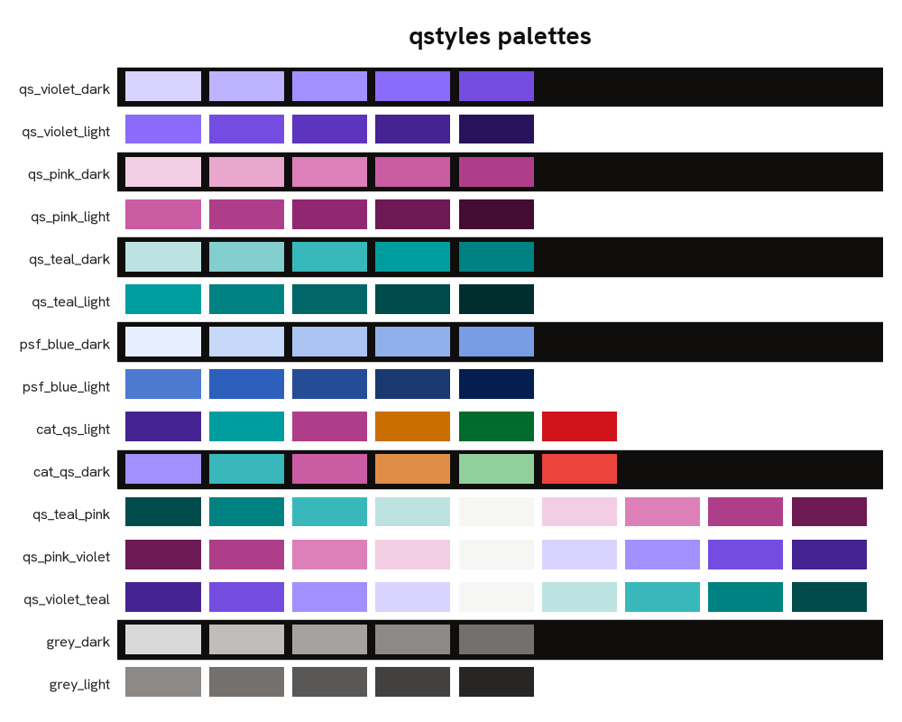

# qstyles

Accessible matplotlib themes and colour palettes in the Quansight brand.

---

**Table of Contents**

- [Installation](#installation)
- [Usage](#usage)
- [Palettes](#palettes)
- [Typeface](#typeface)
- [Example images](#example-images)
- [License](#license)

## Installation

```console
pip install git+https://github.com/Quansight-Labs/a11y-data-viz
```

## Usage

```python
import matplotlib.pyplot as plt
import qstyles

qstyles.light_theme(palette="cat_qs_light")
# or: qstyles.dark_theme(palette="cat_qs_dark")

fig, ax = plt.subplots()
```

Both themes also take `context` (`"notebook"`, `"print"` or
`"presentation"`), `grid` and `minimal`. With no palette, the theme uses
violet.

## Palettes



| Type        | Palettes                                                            |
| ----------- | ------------------------------------------------------------------- |
| Sequential  | `qs_violet`, `qs_pink`, `qs_teal`, `psf_blue` (each `_light`/`_dark`) |
| Categorical | `cat_qs_light`, `cat_qs_dark`                                       |
| Diverging   | `qs_teal_pink`, `qs_pink_violet`, `qs_violet_teal`                  |
| Base        | `grey_light`, `grey_dark`                                           |

Use the `_light` palettes with `light_theme` and the `_dark` palettes with
`dark_theme`. Every colour in them has at least 3:1 contrast against the
theme background (WCAG 1.4.11), and the categorical palettes stay
distinguishable under the common forms of colour blindness. The tests check
the contrast.

The diverging palettes are designed for light backgrounds. Dark versions
are not available yet.

The colours come from the Quansight brand colour system.

## Typeface

The themes use [Hanken Grotesk](https://github.com/marcologous/hanken-grotesk),
the Quansight brand typeface for numbers and data visualisation. It is
bundled with the package, so nothing needs installing. See
`src/qstyles/vendor/HankenGrotesk/` for the licence.

## Example images

`examples/images/` has bar, line, scatter and grid plots for every palette,
and heatmaps for the diverging palettes. Regenerate them after changing a
palette or theme:

```console
python scripts/render_examples.py
```

## License

`qstyles` is distributed under the terms of the
[BSD 3-Clause](https://spdx.org/licenses/BSD-3-Clause.html) license.
